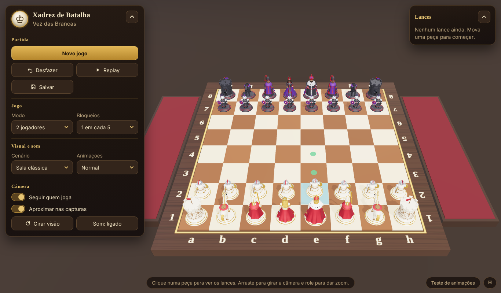

<div align="center">

# ♛ Xadrez de Batalha 3D

**Um xadrez 3D no navegador onde cada captura vira uma pequena batalha.**

*Projeto de tempo livre.*

[](https://luisbobsled.github.io/Xadrez_3D/)


-3776AB?style=flat-square&logo=python&logoColor=white)




</div>

---

## 🏰 Sobre

As peças têm a forma do que representam: o peão é um soldado, a torre é uma torre de castelo, o cavalo é um cavalo de verdade, e assim por diante. Elas foram **modeladas no Blender por script** e ganharam animações de espera com keyframes: respiram, balançam a capa, abanam a cauda.

Quando uma peça captura outra, não é só "sumir do tabuleiro": cada tipo de peça tem o seu ataque, cada vítima morre de um jeito, e a alma dela voa até o cemitério de quem venceu.

## ⚔️ As peças e suas habilidades

| Peça | Personagem | Ataque | Defesa (às vezes) | Morte |
|:---:|---|---|---|---|
| ♙ | Soldado com elmo, espada e escudo | Saca a espada e corta a vítima ao meio | Ergue o escudo | O elmo sai rolando |
| ♖ | Torre de castelo com canhão | Dispara uma bala de canhão | Baixa a grade de ferro e revida | Desmorona em blocos de pedra |
| ♘ | Cavalo com sela e crina | Salta, empina e dá um coice | Desvia de lado | As ferraduras voam |
| ♗ | Bispo de mitra e báculo | Invoca raios do céu | Cúpula de luz | Vira cinzas, com marca de queimado |
| ♕ | Rainha de vestido e coroa | Lança uma esfera mágica | Desvia com a varinha | Se desfaz em pétalas |
| ♔ | Rei de barba, capa e maça | Esmaga com a maça | Apara o golpe | A coroa sai rolando |

No **xeque-mate**, o rei derrotado treme em câmera lenta, vira pó e é levado pelo vento. Depois aparece **VITÓRIA**.

## ✨ Recursos

<table>
<tr>
<td width="50%" valign="top">

**🎮 Modos de jogo**
- 2 jogadores no mesmo computador
- Contra o computador (fácil, médio e difícil)
- IA contra IA, com nível separado para cada lado
- **Modo Hacker** (botão H): mostra a melhor jogada e prevê a resposta do adversário
- **Teste de animações**: escolha qualquer atacante e vítima

</td>
<td width="50%" valign="top">

**🎬 Batalhas**
- Duelos com bloqueio e contra-ataque em 1 de cada 5 capturas
- Câmera cinematográfica que gira em volta da luta
- Últimas palavras da vítima, luto do time e combos
- Alma da peça voando até o cemitério
- Sons sintetizados para cada golpe

</td>
</tr>
<tr>
<td valign="top">

**🌄 Cenários**
- Sala clássica
- Pátio do castelo, com tochas acesas
- Campo de batalha, com chuva e trovões
- Salão do trono

</td>
<td valign="top">

**🧰 Conforto**
- Desfazer lance (`Ctrl + Z`)
- Replay da partida inteira ou só das mortes
- Salvamento automático
- Versão para celular com menu recolhível

</td>
</tr>
</table>

## ♟️ Regras completas e testadas

Todas as regras oficiais estão implementadas: **roque, en passant, promoção** com escolha da peça, xeque, xeque-mate, afogamento, regra dos 50 lances, repetição tripla e material insuficiente.

O gerador de lances foi validado com **perft**, o teste usado pelos motores de xadrez. Em 6 posições de referência (incluindo a famosa *Kiwipete*), a contagem de lances bateu com os valores oficiais até 5 jogadas de profundidade, num total de mais de 1,5 milhão de posições.

## 🕹️ Como jogar

1. Abra o **[link do jogo](https://luisbobsled.github.io/Xadrez_3D/)**. Não precisa instalar nada.
2. Clique numa peça para ver os lances possíveis e depois na casa de destino.
3. Arraste para girar a câmera e use a roda do mouse para dar zoom.

Também dá para baixar o `index.html` e abrir direto no navegador.

## 🛠️ Como foi feito

| Parte | Tecnologia |
|---|---|
| Gráficos 3D | Three.js: sombras, partículas, planos de recorte para o corte da espada |
| Modelos e animações | Blender 5.3, gerados por script Python (`bpy`) e exportados em glTF |
| Motor de xadrez | JavaScript puro, validado com perft |
| IA | Minimax com poda alfa-beta, busca quiescente e aprofundamento iterativo num Web Worker |
| Distribuição | Um único `index.html`, com os modelos embutidos |

<details>
<summary><b>📁 Estrutura do projeto</b></summary>

```
index.html              jogo pronto, com os modelos embutidos
src/index.src.html      código-fonte do jogo
assets/pieces.glb       peças exportadas do Blender
assets/scenes.glb       cenários exportados do Blender
blender/                scripts que geram os modelos no Blender
build.py                monta o index.html a partir do src e dos assets
docs/capa.png           imagem do README
```

</details>

<details>
<summary><b>🔧 Gerar os modelos de novo</b></summary>

1. Abra o Blender, vá na aba **Scripting**, crie um texto novo e cole `blender/build_pieces.py`.
2. Rode com **Alt + P**. O script cria uma cena "Xadrez" com as peças e exporta o modelo para `Documentos/xadrez3d`.
3. Copie o arquivo gerado para `assets/pieces.glb` e rode:

```bash
python build.py
```

</details>

---

<div align="center">

Feito por **Luis Filipe Seixas de Souza** como projeto pessoal.

[](https://www.linkedin.com/in/luis-filipe-seixas-de-souza-3942562b6)
[](https://github.com/luisbobsled)

</div>
